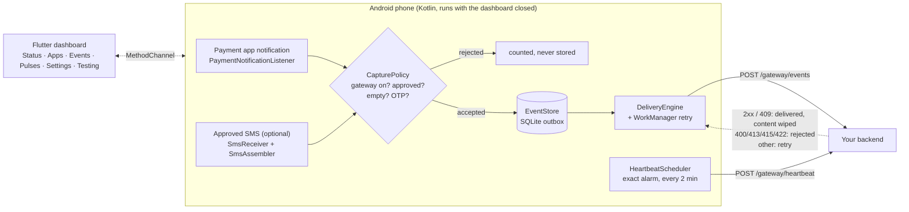
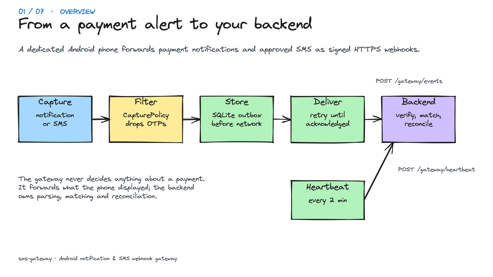
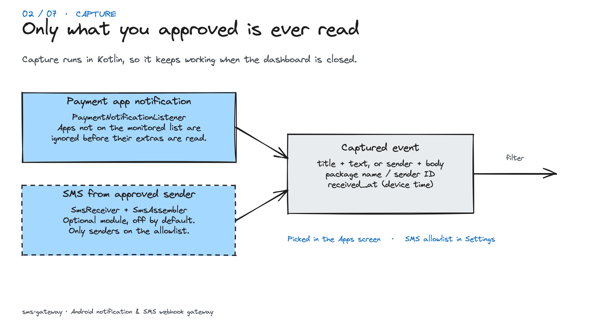
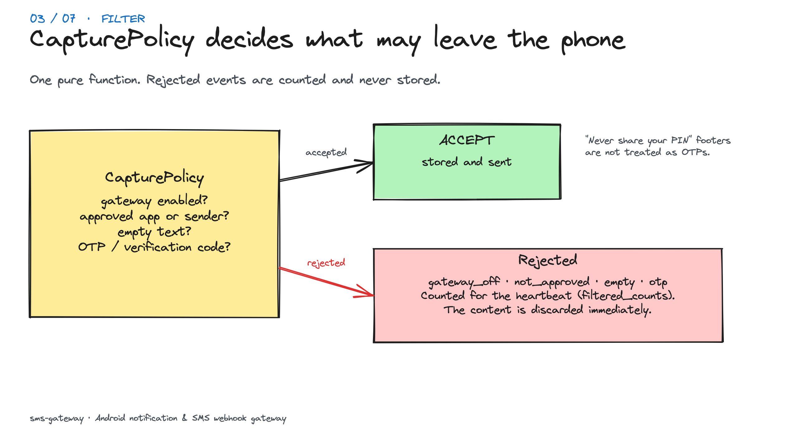
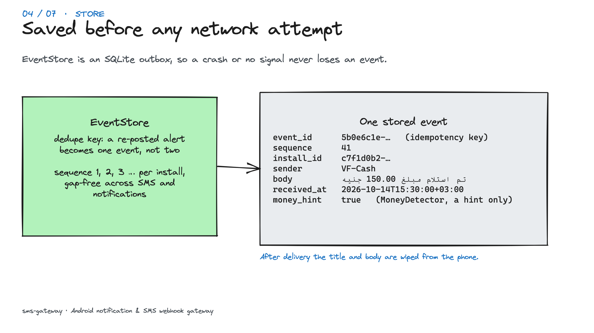
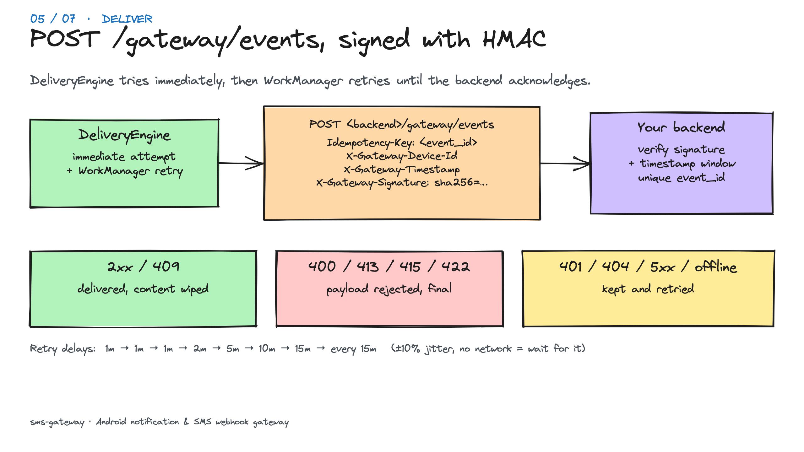
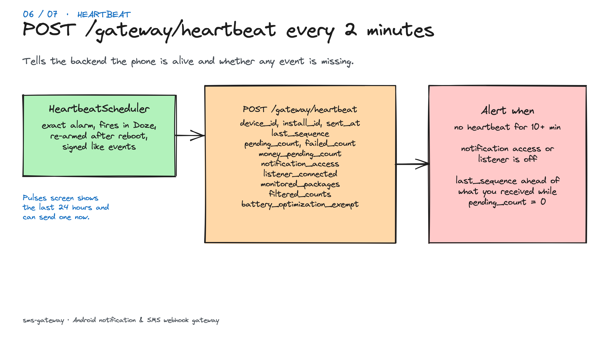
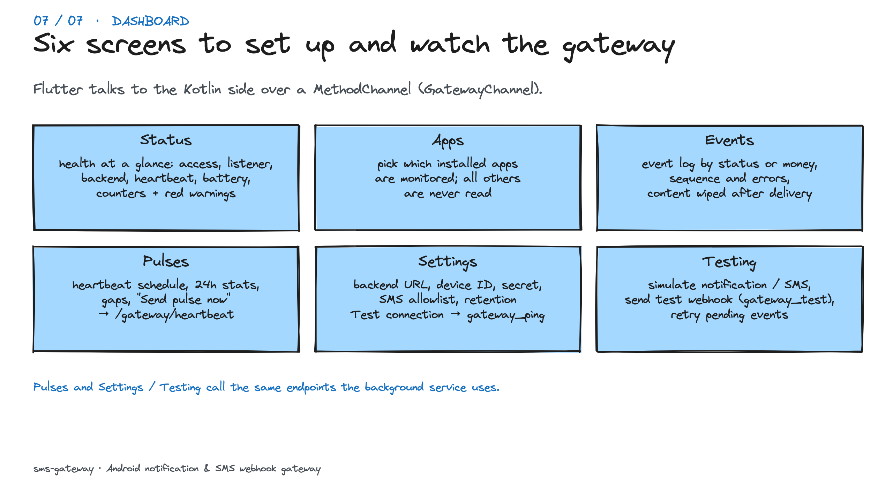

# sms-gateway

An Android **Notification & SMS Webhook Gateway**. It runs on a dedicated
phone, watches payment notifications from apps the operator picks (banking
apps, InstaPay, wallets) and, optionally, SMS from approved senders. It
forwards each event to your backend over signed HTTPS, and retries until the
backend acknowledges it.

**The gateway never decides anything about a payment.** It forwards what the
phone displayed. The backend owns parsing, matching events to pending orders,
reconciling against an authoritative provider or bank record, and fulfilling
whatever was paid for. Notification or SMS text alone is never proof of payment.

Android only, sideloaded (not on Google Play). No Firebase, no analytics, no
third-party cloud. The only runtime dependency is `androidx.work`.

---

## How it works



Both paths are defined in
[`WebhookEndpoint.kt`](android/app/src/main/kotlin/dev/smsgateway/app/config/WebhookEndpoint.kt).

### Walkthrough

<table>
  <tr>
    <td colspan="2"></td>
  </tr>
  <tr>
    <td width="50%"><br><sub><b>2. Capture.</b> Only monitored apps and approved senders are read.</sub></td>
    <td width="50%"><br><sub><b>3. Filter.</b> CapturePolicy drops OTPs, empty and unapproved events.</sub></td>
  </tr>
  <tr>
    <td><br><sub><b>4. Store.</b> Written to the outbox before any network attempt.</sub></td>
    <td><br><sub><b>5. Deliver.</b> <code>POST /gateway/events</code>, retried until acknowledged.</sub></td>
  </tr>
  <tr>
    <td><br><sub><b>6. Heartbeat.</b> <code>POST /gateway/heartbeat</code> for completeness alerts.</sub></td>
    <td><br><sub><b>7. Dashboard.</b> What each of the six screens is for.</sub></td>
  </tr>
</table>

The slides are drawn in Excalidraw; open
[`docs/flow/gateway-flow.excalidraw`](docs/flow/gateway-flow.excalidraw) at
excalidraw.com to edit them.

### Dashboard screens

| Screen | What it is for |
|---|---|
| **Status** | Health at a glance: notification access, listener, SMS, backend, heartbeat, battery, event counters, and red warnings that link to the fix. |
| **Apps** | Pick which installed apps are monitored. Notifications from every other app are never read. |
| **Events** | The local event log. Filter by status or money, see sequence numbers and backend errors, reveal content until it is wiped after delivery. |
| **Pulses** | Heartbeat schedule, the last 24 hours of pulses (sent, failed, gaps) and *Send pulse now*, which calls `/gateway/heartbeat`. |
| **Settings** | Backend URL, device ID, HMAC secret, gateway on/off, SMS allowlist and retention. *Test connection* sends a `gateway_ping` to `/gateway/events`. |
| **Testing** | Simulate a notification or SMS (local only, or sent as a sample), send a test webhook (`gateway_test`), send a heartbeat, retry pending events. |

**Flutter is not on the critical path.** Capture, filtering, storage and
delivery all run in Kotlin. Capture never depends on a Dart isolate staying
alive. The dashboard can be closed.

### Project structure

```
android/app/src/main/kotlin/dev/smsgateway/app/
  capture/
    CapturePolicy.kt        the one place that decides what may leave the phone (pure)
    OtpFilter.kt            drops OTPs / verification codes (pure)
    MoneyDetector.kt        generic money_hint (pure)
    EventIngestor.kt        filter → persist → schedule
    notification/           PaymentNotificationListener, NotificationExtractor (pure),
                            NotificationAccess, InstalledApps
    sms/                    SmsReceiver, SmsAssembler (pure), SenderFilter (pure), SmsModule
  queue/                    EventStore (SQLite outbox), GatewayEvent
  delivery/                 DeliveryEngine, DeliveryWorker, DeliveryScheduler, DeliveryPolicy,
                            WebhookClient, WebhookPayload, RequestSigner, Heartbeat, HeartbeatScheduler, BootReceiver
  config/                   GatewaySettings, SecretStore (Keystore), WebhookEndpoint
  channel/                  GatewayChannel: the Flutter ↔ native bridge
lib/
  domain/                   entities, GatewayRepository, SettingsValidator, gatewayWarnings
  data/                     MethodChannelGatewayRepository
  presentation/             DashboardController; Status, Apps, Events, Pulses, Settings, Testing screens
  core/                     masking, formatting
```

---

## What is captured, and what never is

| Source | Forwarded only when | Never forwarded |
|---|---|---|
| Notification | Gateway on, Notification Access granted, and the posting **package is on the monitored list** | Any other app (its extras are never read), group summaries, ongoing/progress notifications, empty notifications, OTPs |
| SMS (optional, off by default) | SMS module on, SMS permission granted, and the **sender is on the approved list** | Unapproved senders, OTPs, anything received while the module is off, historical inbox messages |

- **Notification updates.** Apps re-post a notification to update it. A
  re-post with the same package, key, `when` and content is a duplicate. A
  second payment with identical text has a new `when`, so it is kept.
- **OTP filter.** Messages naming a one-time code are dropped, even from
  approved sources: OTP, one-time password, verification code, رمز التحقق,
  كود التفعيل and similar. Generic boilerplate such as *"never share your PIN"*,
  which banks append to real transaction alerts, is **not** matched. Dropped
  events are only **counted** (Status → Events → "Filtered out"), never stored,
  so a lost payment alert would show up as a rising count.
- **SMS module.** The SMS permission is requested only when the operator turns
  the module on. With it off, the `SmsReceiver` component is disabled, so
  Android doesn't deliver SMS broadcasts to the app at all. The app never
  reads the inbox and never sends, modifies or deletes SMS.
- **Sender matching** ignores case, spaces and dashes. Egyptian numbers match
  with or without `+20` / `0020`.

---

## Webhook contract (for the backend)

`POST <backend-url>/gateway/events`

**Every event, SMS or notification, uses the same fields,** so the backend
needs only one schema for both.

SMS:

```json
{
  "event_id": "5b0e6c1e-6a0b-4b8e-9d0f-2f1b7c0b9a41",
  "device_id": "android-gateway-001",
  "sender": "VF-Cash",
  "body": "تم استلام مبلغ 150.00 جنيه من 01012345678 ...",
  "received_at": "2026-10-14T15:30:00+03:00",
  "source": "android_sms",
  "sequence": 41,
  "install_id": "c7f1d0b2-3e4a-4f5b-8c6d-7e8f9a0b1c2d",
  "money_hint": true
}
```

Notification, mapped onto the same fields:

```json
{
  "event_id": "9a1f…",
  "device_id": "android-gateway-001",
  "sender": "com.example.paymentapp",
  "body": "Payment received\nYou received a payment of 100.00 EGP\n[via notification: com.example.paymentapp]",
  "received_at": "2026-10-14T15:30:00+03:00",
  "source": "android_notification",
  "sequence": 42,
  "install_id": "c7f1d0b2-3e4a-4f5b-8c6d-7e8f9a0b1c2d",
  "money_hint": true
}
```

| Field | Notes |
|---|---|
| `event_id` | UUID, created once when the event is stored. **Every retry reuses it**, so it is the idempotency key. |
| `sender` | SMS: the sender ID or number as the network supplied it. Notification: **the posting app's package name**, which is stable per app like a sender ID. Always a string. |
| `body` | SMS: the full text, multipart joined. Notification: the title (unless the text already starts with it), then the fullest text (big text, then inbox lines, then text), then a last line `[via notification: <package>]`. UTF-8, Arabic preserved. |
| `received_at` | When the phone captured it. ISO-8601 with the device's UTC offset, second precision. |
| `source` | Where the event came from: `android_sms` or `android_notification` for real events, `simulated_sms` or `simulated_notification` from the Testing screen, `gateway_test` from *Send test webhook*, `gateway_ping` from *Test connection*. **Only `android_sms` and `android_notification` may ever activate anything.** |
| `sequence` | 1, 2, 3 … per `install_id`, gap-free across SMS and notifications. See [Completeness](#completeness). |
| `install_id` | Random per install. It changes on reinstall or *Clear data*, which is when `sequence` restarts at 1. |
| `money_hint` | Generic "mentions money" hint. **A hint only, not a decision.** |

**Notifications need no separate endpoint.** They arrive on the same
endpoint with `source: android_notification`. Their `sender` is the app's
package name (for example `com.egyptianbanks.instapay`) and their body ends
with `[via notification: <package>]`, so the backend's parser can recognize
package names the way it recognizes SMS sender IDs. If the backend rejects an
event with a 4xx, the event log shows the field or message it returned.

`gateway_ping` (from **Test connection**) is never stored and has no
`sequence`. Return 2xx and ignore it.

### Authentication: per-device HMAC

```
Idempotency-Key:      <event_id>
X-Gateway-Device-Id:  <device_id>
X-Gateway-Timestamp:  <unix seconds>
X-Gateway-Signature:  sha256=<hex HMAC-SHA256(secret, "<timestamp>.<raw body>")>
```

The backend provisions one secret per `device_id`; keep it in your secrets
manager. The operator enters it once, and the phone keeps it encrypted with a
non-exportable Android Keystore key. The secret is never transmitted, never
logged, and can't be read back by the UI.

```python
import hmac, hashlib, time
from fastapi import Request, HTTPException

async def verify_gateway(request: Request, secret: str) -> bytes:
    raw = await request.body()
    ts = request.headers.get("X-Gateway-Timestamp", "")
    sig = request.headers.get("X-Gateway-Signature", "")
    if not ts.isdigit() or abs(time.time() - int(ts)) > 300:
        raise HTTPException(401, "stale timestamp")
    expected = "sha256=" + hmac.new(secret.encode(), f"{ts}.".encode() + raw, hashlib.sha256).hexdigest()
    if not hmac.compare_digest(expected, sig):
        raise HTTPException(401, "bad signature")
    return raw
```

Because of the ±5 minute window, **the phone must keep automatic date & time
on**.

### Response codes

| Backend returns | Gateway does |
|---|---|
| `2xx`, **after the event is committed** | Marks it **delivered** and wipes title and body on the phone |
| `409` | **Delivered** (you already have this `event_id`) |
| `400`, `413`, `415`, `422` | **Failed**, permanent. It stays visible and can be retried manually. |
| Anything else: `401`, `403`, `404`, `429`, `5xx`, timeout, TLS/DNS error | **Retry** after 1, 1, 1, 2, 5 and 10 min, then every 15 min, forever (±10% jitter) |

Delivery is **at least once**. Put a unique constraint on `event_id`, and
answer a repeat with 200 or 409. Never activate twice.

### Completeness

1. **Sequence gaps.** Every stored event that will be sent takes the next
   `sequence` from a counter that only moves on a successful insert.
   Duplicates, filtered events and simulated events never take a number. A gap
   that lasts more than ~30 minutes means an event is missing:

   ```sql
   SELECT d.device_id, d.install_id, s.seq AS missing_sequence
   FROM (SELECT device_id, install_id, max(sequence) AS max_seq
         FROM sms_events GROUP BY device_id, install_id) d
   CROSS JOIN LATERAL generate_series(1, d.max_seq) AS s(seq)
   LEFT JOIN sms_events e
          ON e.device_id = d.device_id AND e.install_id = d.install_id AND e.sequence = s.seq
   WHERE e.sequence IS NULL;
   ```

2. **Heartbeat.** `POST <backend-url>/gateway/heartbeat` arrives about
   every 2 minutes, with the same signing as events:

   ```json
   {
     "device_id": "android-gateway-001", "install_id": "…", "sent_at": "…",
     "last_sequence": 42, "pending_count": 0, "failed_count": 0,
     "money_pending_count": 0, "money_failed_count": 0, "oldest_pending_received_at": null,
     "last_sms_received_at": null, "last_notification_at": "…", "last_delivered_at": "…",
     "forwarding_enabled": true,
     "notification_access": true, "notification_listener_connected": true,
     "monitored_packages": ["com.example.paymentapp"],
     "sms_enabled": false, "sms_permission": false,
     "filtered_counts": {"otp": 2, "not_approved": 0},
     "battery_optimization_exempt": true, "app_version": "1.0.0"
   }
   ```

   Alert when:
   - no heartbeat has arrived for 10 minutes or more (the phone is off, offline
     or force-stopped);
   - `notification_access` or `notification_listener_connected` is false;
   - `last_sequence` is above your max for the install while
     `pending_count = 0`;
   - `money_pending_count > 0` for a while.

3. **Reconciliation.** Match each event against the pending order **and**
   against the provider's or bank's own record before activating anything. The
   gateway is an early signal, not the ledger.

---

## Reliability

| Situation | Behaviour |
|---|---|
| Event captured | It is written to SQLite first. Then an immediate in-process send runs, with expedited WorkManager work already queued as the fallback. |
| No network | Stays queued. This **doesn't count as a failed attempt**. Network-constrained work fires on reconnect. |
| Request failed | Retries at 1, 1, 1, 2, 5, 10 min, then every 15 min, forever. A circuit breaker holds the rest of the queue so a dead backend doesn't cost one timeout per event. |
| UI closed / process killed | The listener is bound by the system and the receiver is manifest-registered. Queued events survive in SQLite, and WorkManager resumes delivery. |
| Reboot | WorkManager reschedules itself. `BootReceiver` re-syncs the SMS module, asks Android to rebind the listener, and kicks a drain. |
| Heartbeat | An exact `setExactAndAllowWhileIdle` alarm every 2 min; it fires inside Doze and wakes the CPU (WorkManager can't: Doze holds its jobs for 5-30+ min with the screen off). Each firing arms the next alarm before it sends. App start, boot, update and the 15-minute job re-arm the chain. Every attempt (due time, send time, result) is logged on the phone and shown in the **Pulses** tab. |
| Listener dropped | `onListenerDisconnected` calls `requestRebind`. The 15-minute job repeats the request while the listener is disconnected. |
| Duplicate notification update / SMS broadcast | Dedupe key. The second one is ignored and takes no sequence number. |
| Retention | Delivered, failed and simulated events older than N days (default 30) are deleted. **Pending events are never purged.** |

### Where delivery cannot be guaranteed

- **Force stop.** *Settings → Apps → Payment Gateway → Force stop* unbinds the
  listener, disables the receiver, and stops WorkManager until someone opens
  the app again. Notifications and SMS that arrive meanwhile are **lost**: the
  gateway never reads history. Only the missing heartbeat reveals this.
- **The payment app has to post the notification.** If the banking or wallet
  app is logged out, killed by its own battery restrictions, has notifications
  turned off, or doesn't get its push message, there is nothing to capture.
  Keep those apps logged in, with notifications on and battery
  **Unrestricted**.
- **Notification Access can be revoked** by the user, and some OEM "security"
  apps revoke it on their own. The dashboard and heartbeat both report it.
- **Restricted settings on Android 13 and later.** For an APK sideloaded from a
  browser or file manager, Android blocks Notification Access until you go to
  *App info → ⋮ → Allow restricted settings*. Installing with `adb install`
  avoids this.
- **Doze and OEM battery managers** (Xiaomi, Huawei, Oppo, Samsung "sleeping
  apps") can delay or kill background work. Capture still happens when the
  listener is bound, but the POST may wait. Keep the phone **plugged in**,
  exempt the app (**Status → Battery optimisation**; the app only opens the
  system dialog, it never changes the setting itself), and see
  https://dontkillmyapp.com. The heartbeat is the exception: its exact alarm
  fires through Doze (Android allows 72 per hour; it uses 30). An app can't
  switch Doze off for itself. `USE_EXACT_ALARM` is granted at install on
  Android 13+; if exact alarms are revoked, Pulses shows it and beats drift.
- **Expedited work has a quota.** Past the quota, work runs as normal deferred
  work. On Android 11 and earlier it briefly shows a "Forwarding payment events"
  notification.

---

## Security and privacy

- **Opt-in at every step.** The gateway is off by default. Notification Access
  is granted by the operator in system settings. Apps are monitored only once
  selected. The SMS module is off by default and has a mandatory sender
  allowlist. **No Accessibility permission** is requested.
- **Least data:**
  - Notifications from unmonitored apps are discarded before their extras are
    read.
  - OTPs are dropped.
  - Filtered events are counted, never stored.
  - A delivered event's title and body are **wiped on the phone** as soon as
    the backend acknowledges it. Only metadata is kept, until retention runs.
- **The event log hides content by default.** The list shows only the source,
  time, status, retry count and failure reason. Content is visible only for
  undelivered events, behind *Reveal content*.
- **Logs** never contain notification or SMS content, senders, or the secret.
- **HTTPS only.** It is enforced by URL validation, the client and
  `network_security_config.xml`. Redirects are not followed, and only the
  configured backend is ever contacted.
- `allowBackup=false` plus data-extraction rules keep the queue out of cloud
  backup and device transfer.
- **Use a dedicated phone and SIM.** Sign in to the payment apps there with the
  receiving account only.

---

## Build and test

```bash
flutter pub get
flutter analyze
flutter test                                       # Dart: entities, validator, warnings, controller, channel
(cd android && ./gradlew :app:testDebugUnitTest)   # Kotlin: filters, OTP, dedupe, payload, retries,
                                                   #   queue persistence + migrations (Robolectric, real SQLite)
flutter build apk --release --split-per-abi
```

`minSdk` is 26. The release build is currently signed with the debug key. Add
your own signing config in `android/app/build.gradle.kts` before rolling out.

---

## Configure the gateway phone

1. **Install.**
   `adb install -r build/app/outputs/flutter-apk/app-arm64-v8a-release.apk`.
   Using adb avoids the Android 13+ restricted-settings block.
2. **Payment apps.** Install and log in to each payment app. Turn its
   notifications on and set its battery to *Unrestricted*.
3. **Phone settings.** Turn on *Automatic date & time*. Keep the phone plugged
   in.
4. Open **Payment Gateway**:
   - **Status → Notification Access → Open.** Enable *Payment Gateway*, then
     check that Listener says *Connected*.
   - **Status → Battery optimisation → Exempt.**
   - **Apps:** switch on each payment app to monitor.
   - **Settings → Webhook:**
     - Backend API URL: your backend's base URL, for example
       `https://api.example.com`
     - Device identifier: for example `android-gateway-001`, exactly as
       provisioned on the backend. The random default gets a 401.
     - Device credential: the HMAC secret for that device ID
   - **Settings → Gateway enabled → Save.**
   - Optional: **Settings → SMS monitoring.** Turning it on asks for the SMS
     permission. Add approved senders, then **Save**.
5. **Settings → Test connection** should report `OK`. The Status tab should
   show no red warnings.

---

## Physical-device testing checklist

**Setup**
- [ ] Status shows Notification Access granted and Listener connected.
- [ ] Only the selected apps appear under Apps → *Selected*.
- [ ] Test connection returns `OK (HTTP 200)`. A wrong secret gives 401, and a
      wrong URL gives 404.

**Local simulator** (Testing tab; nothing leaves the phone with *Local only*)
- [ ] Simulate a notification for a monitored app: result `simulated`, and it
      appears in Events with status *simulated* and no sequence.
- [ ] Simulate the same app with the text `Your OTP is 123456`: result
      `filtered: otp`, and nothing is stored.
- [ ] Simulate an SMS from an unapproved sender: `filtered: not_approved`.
      With SMS monitoring off: `filtered: source_disabled`.
- [ ] Untick *Local only*: the event is sent with
      `source: simulated_notification`. Check that the backend stores it but
      doesn't activate anything.

**Real notifications**
- [ ] Make a small real payment to the account. The event appears within
      seconds, then turns *delivered*, and its content then shows "removed
      after delivery".
- [ ] Check that a notification from an unmonitored app (for example a chat
      message) never appears in Events.
- [ ] Check that a notification update (the same alert re-posted) creates one
      event, not two.

**SMS module** (if used)
- [ ] An Arabic SMS longer than 70 characters from an approved sender arrives
      as **one** event with the full text.
- [ ] An SMS from any other number is not captured.

**Failure drills**
- [ ] *Offline:* turn on airplane mode and trigger a simulated (not local)
      event. It stays pending. Turn airplane mode off, and it is delivered.
- [ ] *Backend down:* point the URL at a host that returns 503. Next attempt
      is about 1 min, three times, then grows. Restore the URL and tap **Retry
      pending & failed**.
- [ ] *Killed:* swipe the app away, then trigger a payment. It is still
      captured and delivered. (Swiping away is not a force-stop.)
- [ ] *Reboot* with an event pending. After boot, the listener reconnects and
      the event is delivered.
- [ ] *Access revoked:* turn off Notification Access. A red Status warning
      appears and the heartbeat reports `notification_access: false`.
- [ ] *Completeness:* tap **Send heartbeat**. The backend's `last_sequence`
      equals its max sequence for this install.

Useful while testing:

```bash
adb logcat -s NotificationListener SmsReceiver DeliveryEngine DeliveryWorker
adb shell dumpsys notification | grep -A3 "Live notification listeners"
adb shell cmd notification post -S bigtext -t "Payment received" test "You received 100 EGP"  # posts as com.android.shell
```
